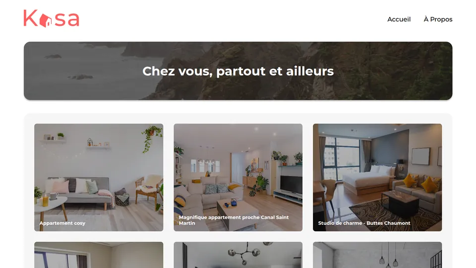

# Kasa : location immobilière en React

Projet 7 du parcours Développeur web d'OpenClassrooms : application de location de logements
entre particuliers, avec routing et composants réutilisables.



## Fonctionnalités

- Page d'accueil : liste des logements, chargée depuis un fichier JSON.
- Fiche logement (`/logement/:id`) : galerie de photos en carrousel, hôte, note et menus
  déroulants pour la description et les équipements.
- Page À propos avec les mêmes menus déroulants.
- Page 404 pour une adresse inconnue ou un logement qui n'existe pas.

Composants réutilisables : `Banner`, `Card`, `Collapse`, `Gallery`, `Header`, `Footer`,
`Layout`.

## Stack

React 19, Vite, React Router, Sass.

## Lancer en local

```
npm install
npm run dev
```

---

Projet présenté dans mon portfolio : https://nicolas-grasser.vercel.app
